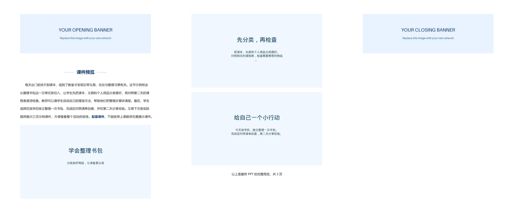

# 课件公众号助手

把一份或一批教学PPT/PDF整理成公众号文章，交付 **标题、2.35:1封面、完整排版的Word导入稿**。文章可存入Obsidian；需要时，由智能体操作已登录的公众号后台，导入正文、插入首尾账号名片、保存并复核草稿。

适合课件展示、主题班会、家长会及教材配套内容。首尾引导图和名片账号由使用者自定，其余文章排版固定。仓库使用无品牌合成示例，不含作者的个人课件、账号凭据或登录会话。

## 实际工作流程

1. 阅读完整课件，核对真实配套资料，写标题和一段教学导语。
2. 生成标题、封面、Word导入稿、Markdown及按顺序排列的全部课件页图。
3. 检查封面。能直接裁好就裁；标题受损、人物被截断或构图不好看，就参考原内容和画风重新设计。
4. 按需把整套目录放入Obsidian。
5. 按需在公众号后台导入Word，恢复正式标题、设置封面；文章摘要可不填。
6. 需要名片时，在开头图之后、结尾图之前各插入一张真实账号名片，简介可留空。
7. 保存后刷新或重新打开，检查图片、排版和两张名片是否保留；正式发表由用户另行决定。

Python脚本负责本地生成。后台导入和名片插入需要智能体具备浏览器/电脑控制能力，并能访问用户已登录的会话；单独运行脚本不会自动上传，也不需要配置AppSecret。遇到扫码、验证码或权限问题需用户处理。

## 固定排版

开头引导图 → 账号名片位置 → 空一行 → 可编辑“课件预览”组件 → 空一行 → 首行缩进的教学导语 → 全部课件页图 → “以上是最终PPT的完整预览，共X页” → 账号名片位置 → 结尾引导图。

标题格式：`学年段/主题/教材内容｜《课件名称》课件`。

资料清单按真实文件填写并加粗，例如 **配套课件＋发言稿＋教案，** 后面接“下面按照上课顺序完整展示课件。”，与导语保持同一段落。正文不插入视频模块。后台摘要可以留空，正文教学导语仍保留。

本地Word只留名片位置；真实名片在Word导入后通过后台组件插入。重新导入会清除名片，需要重新插入并验收。未要求名片时保留空位，不强制绑定账号。

## 安装与使用

将仓库文件夹命名为 `ppt-wechat-article`，放到自己的 `~/.codex/skills/`，然后让Codex使用 `$ppt-wechat-article`。其他智能体按各自Skill安装规则放置。

也可直接运行脚本，要求Python 3.10+。在仓库目录执行：

```bash
python -m pip install -r requirements.txt
python scripts/build_article.py --source examples/source --metadata examples/metadata.json --output output/demo
```

Windows可将 `python` 换成 `py -3`。每次使用新的或空的输出目录，已有成品不会被覆盖。

换成自己的资料：准备最终PDF、对应PPTX及配套资料；按[配置规则](references/metadata-schema.md)填写标题、候选摘要、单段导语与真实资源路径，指定自己的首尾图。

```bash
python scripts/build_article.py --source "课件文件夹" --metadata "内容配置.json" --opening-image "开头图.png" --closing-image "结尾图.png" --output "output/文章"
```

多个PDF时使用 `--pdf "最终版.pdf"`。只有唯一PPTX时，可在Windows PowerPoint下自动导出PDF，需pywin32；其他系统先自行导出PDF。脚本不调用大模型撰文，使用Skill时由智能体阅读材料后写内容配置。

## 封面规则

统一 **1880×800（2.35:1）**，画面铺满，标题完整、清楚。默认裁取首页，可用 `--cover-focus-y 0.5` 居中，0靠上、1靠下。裁切不好看时，提取原内容、配色和画风，重新设计后通过 `--cover "审核封面.png"` 使用；保留设计原图和提示词。

不把整张首页缩成居中小图补大留白，不拉伸原图。横版和方形分别取景，不能为兼顾方形而缩小横版主体。默认方形检查图仅是参考。详细审核标准和批量换封面命令见[封面制作与复核](references/cover-rules.md)。批量裁切脚本不会自动调用图片生成，也不能直接覆盖已审核的重设计封面。

## 进入公众号草稿箱

使用后台“文档导入”上传Word，随后恢复正式标题、设置封面和可选摘要，再插入所需的两张账号名片，保存并刷新验收。导入可能把文件名当作标题，也会清除已插入的名片。详细步骤见[后台导入与验收](references/wechat-draft-import.md)。

名片简介和文章摘要都可以留空。验证正文图片数为课件页数＋2张引导图，账号名片另计；还须核对标题、页序、字重、缩进、结语、名片位置和封面。编辑区显示正常不能代替保存后的验收，手机效果需单独预览。

随包的Windows“一键复制”入口仅供辅助使用。实测本地图片粘贴后可能被过滤，含图片的文章优先Word导入。Markdown用于存储编辑，公众号发布排版以导入稿及后台验收结果为准。

## 示例与产物

仓库自带三页合成示例《学会整理书包》：`examples/source/` 为输入，`examples/metadata.json` 为内容配置，`examples/result/` 为完整成品。示例不包含真实账号名片；首尾图为可替换占位图。



| 文件 | 用途 |
| --- | --- |
| 公众号标题.txt | 后台标题栏 |
| 公众号封面图.png | 2.35:1横版封面 |
| 公众号文章导入稿.docx | 后台文档导入，含完整页图和排版 |
| 文章正文.md、pages/ | Obsidian编辑存储及全部课件页图 |
| 首尾引导图、发布信息.txt | 正文素材和候选发布信息 |
| 封面方形裁切检查.png | 默认方形取景参考，需后台单独检查 |
| 生成检查.txt | 本地检查结果与待验收项 |
| 一键复制到公众号.cmd | Windows辅助复制入口 |

存入Obsidian时复制整套目录并保持相对路径，不要求安装公众号插件。文章中的资料清单只写实际存在的文件，不自动添加发言稿、教案或视频。

## 验证、许可与适用范围

```bash
python -m unittest discover -s tests -v
```

自编代码、说明和合成示例采用MIT许可，第三方依赖遵循各自许可证；再分发或商业集成时需核对PyMuPDF等依赖许可。使用者自行确认课件、品牌图和字体的使用权。

本机Windows已测试本地生成、后台Word导入保存及首尾双名片保存后刷新保留；这不代表独立脚本已实现无人值守上传。macOS/Linux及手机真机预览未实机验收。后台界面和导入规则可能变化，以实际保存并重新打开后的结果为准。
