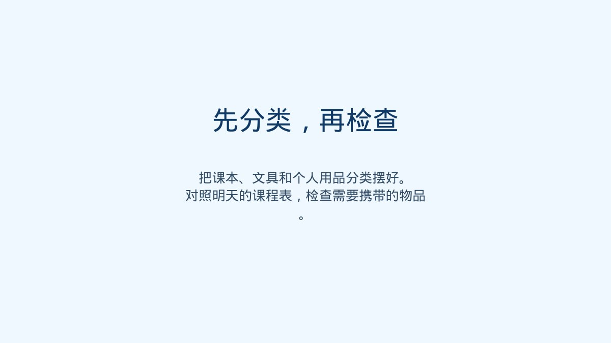

&nbsp;

&nbsp;

## 课件预览

&nbsp;

每天出门前找不到课本，或到了教室才发现忘带文具，往往与整理习惯有关。这节示例班会从整理书包这一日常任务切入，让学生先把课本、文具和个人用品分类摆好，再对照第二天的课程表逐项检查。教师可以请学生说说自己的摆放方法，帮助他们把整理步骤讲清楚。最后，学生选择在放学后独立整理一次书包，完成后对照清单自查，并在第二天分享经验。文章下方按实际顺序展示三页示例课件，方便查看整个活动的安排。<strong>配套课件，</strong>下面按照上课顺序完整展示课件。

以上是最终PPT的完整预览，共3页

&nbsp;

